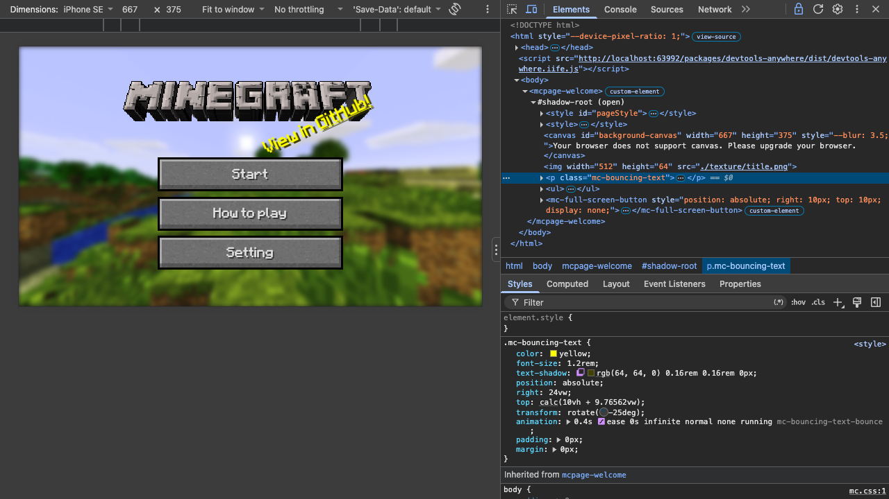
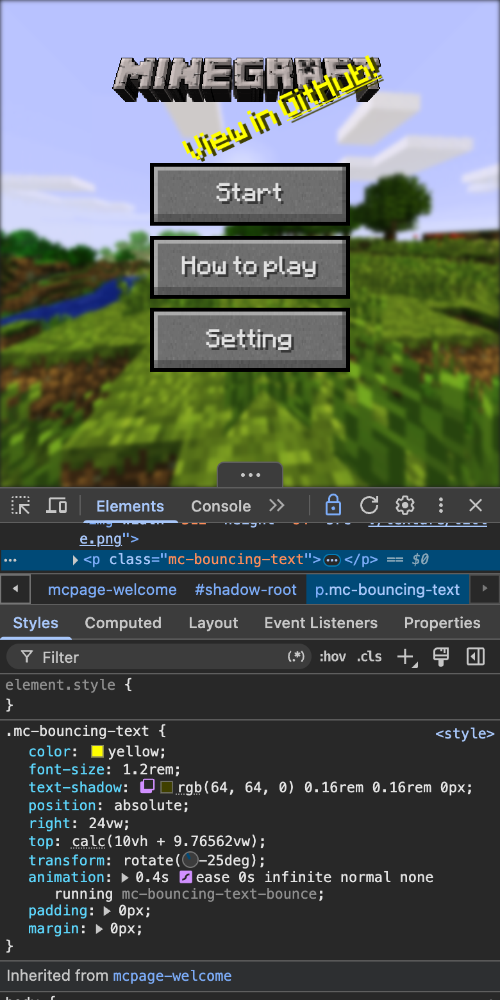

# devtools-anywhere

English | [简体中文](README.zh-CN.md)

Real Chrome DevTools inside any web page, phones included.

<figure>
<p align="center">
  
  
</p>
<figcaption><p align="center"><sub>Screenshots: <a href="https://github.com/jerrychan7/WebMC">WebMC</a>, a Minecraft in WebGL, with devtools-anywhere. Left: device mode on a computer. Right: on a phone.</sub></p></figcaption>
</figure>

## Why

| | devtools-anywhere | eruda / vConsole | Chii |
|---|---|---|---|
| UI | The latest Chrome DevTools | A panel of their own | An old Chrome DevTools (about 122) |
| The page's earliest logs and errors | ✅ From the first script | ❌ Lost until they load | ✅ |
| Setup | One `<script>` or a Vite plugin | One `<script>` | Cumbersome |

## Quick start

**Vite**, during `vite serve` only:

```bash
npm i -D @devtools-anywhere/vite-plugin
```

```js
// vite.config.js
import devtoolsAnywhere from '@devtools-anywhere/vite-plugin'

export default { plugins: [devtoolsAnywhere()] }
```

**Any page**, from a CDN, first in `<head>` (shell mode is not supported from a CDN, so it is turned off):

```html
<script src="https://cdn.jsdelivr.net/npm/devtools-anywhere@0.1.0/dist/probe.iife.js"
  data-devtools-frontend-url="https://cdn.jsdelivr.net/npm/@devtools-anywhere/devtools-frontend@0.1.0/dist/anywhere_app.html"
  data-default-shell-mode="off"></script>
```

Open the page and tap the **F12** button.

**A page on a phone, from a computer**:

```bash
npx -p @devtools-anywhere/remote-server devtools-anywhere-remote
```

Add the printed `<script>` to the page, open the printed target list on the computer, and click "inspect".

Self-hosting, every option and the element: see the [usage guide](docs/usage.md).

## Common options

| `<script>` attribute | Vite option | Effect |
|---|---|---|
| `data-open-immediately` | `openImmediately` | Opens DevTools as the page loads |
| `data-default-shell-mode="off"` | `defaultShellMode: 'off'` | No shell mode: the panel covers the page |
| `data-no-toggler` | `noToggler` | Hides the F12 button |
| `data-remote` | `remote` | Connects to a remote debugging server |

Shell mode (on by default when self-hosted) puts the page in an iframe, so DevTools stay open across reloads and device mode works: see [shell mode](docs/usage.md#shell-mode).

## What works

| Panel | Support |
|---|---|
| Elements, Styles | ✅ Without the browser's default styles |
| Console | ✅ Including the page's earliest output |
| Network | ✅ No real timing; no WebSocket handshake headers |
| Sources | ⚠️ Files and snippets, no breakpoints |
| Application | ✅ |
| Device mode | ⚠️ Shell mode only; size only, not pixel ratio, user agent or touch |
| Screencast, screenshots | ⚠️ Redrawn from the DOM, not the screen's pixels |
| Performance, Memory, Profiler | ❌ Page scripts cannot get this data |

The page side uses only standard web APIs and works in any modern browser; the DevTools UI is verified in Chrome only. All the limits: see the [usage guide](docs/usage.md#limitations).

## Packages

| Package | For |
|---|---|
| `devtools-anywhere` | The probe and the in-page element |
| `@devtools-anywhere/devtools-frontend` | The DevTools frontend (English and Chinese UI) |
| `@devtools-anywhere/devtools-frontend-locales` | Optional: the other 80 UI languages |
| `@devtools-anywhere/vite-plugin` | Vite plugin |
| `@devtools-anywhere/remote-server` | Remote debugging server and CLI |

## Documentation

- [Usage guide](docs/usage.md): every way to set it up, the options, the limits
- [Design](docs/design.md): how it works and why
- [Development guide](DEV.md): setup, tests, releases

## License

[MIT](LICENSE). Third-party code in the published packages (the Chrome DevTools frontend, snapDOM, es-module-lexer) and its licenses: [THIRD_PARTY_LICENSES.md](THIRD_PARTY_LICENSES.md).
